# Расчет бизнес-модели водомата

Сгенерировано `pipeline/business_model.py` из схемы входов v4. Пустые входы остаются «не найдено»; отсутствие значения не трактуется как ноль.
Доля налога ниже — только явно введенная эффективная нагрузка на выручку по заключению бухгалтера; это не утверждение о налоговом режиме Сербии.
**Финансовый вердикт: данных недостаточно.** Не заполнено обязательных полей: 34. Запуск и инвестиционное решение по этой модели не подтверждены.

## Стадии pipeline

| Этап | Статус | Детали |
|---|---|---|
| `validate_configuration` | passed | — |
| `assemble_business_model_canvas` | passed | 12 |
| `calculate_unit_economics` | incomplete | volume_lpd, uptime_rate, cashless_revenue_share, cashless_order_share, cashless_fee_rate, effective_sales_tax_rate, sewer_tariff_rsd_m3, sewer_billing_basis, ro_intake_l_per_product_l, other_variable_cost_rsd_l, average_order_l, cash_handling_cost_rsd_per_cash_order, refund_and_failed_sale_cost_rsd_per_order, capex_breakdown.equipment, capex_breakdown.delivery_and_installation, capex_breakdown.site_preparation, capex_breakdown.permits_and_documentation, capex_breakdown.opening_consumables, startup_cash_requirements.lease_deposit, startup_cash_requirements.prepaid_rent, startup_cash_requirements.cash_float_for_change, startup_cash_requirements.opening_working_capital, monthly_fixed_costs.rent, monthly_fixed_costs.electricity, monthly_fixed_costs.telemetry_and_connectivity, monthly_fixed_costs.service_and_filters, monthly_fixed_costs.labor_and_cash_collection, monthly_fixed_costs.laboratory_and_quality, monthly_fixed_costs.insurance, monthly_fixed_costs.other, monthly_fixed_costs.water_readiness_fee, monthly_fixed_costs.customer_support, monthly_fixed_costs.on_site_labor, monthly_fixed_costs.local_marketing |
| `market_sizing` | incomplete | eligible_households, average_household_liters_month, serviceable_share, obtainable_share |
| `customer_economics` | incomplete | monthly_acquisition_spend_rsd, new_customers_per_month, liters_per_customer_month, customer_lifetime_months, contribution_per_liter |
| `scenario_analysis` | incomplete | — |
| `sensitivity_analysis` | incomplete | — |
| `launch_decision` | requires_external_clearances | docs/certification/requirements-map.md, docs/hardware/site-selection-scorecard.md, docs/decisions/0011-pilot-gate.md |
| `publish_reproducible_package` | ready | Markdown report, Mermaid diagram, JSON results |

## Структурная бизнес-модель

Эти поля загружаются из конфигурации и проходят тот же pipeline, что расчеты. Статус показывает, решение это, гипотеза или неизвестное.

| Блок модели | Формулировка | Статус | Источник |
|---|---|---|---|
| Оператор и юридическая форма | Сербское DOO | owner_decision | `docs/project/business-model.md` |
| Клиентский сегмент | Жители многоквартирного жилого дома, у которого размещена точка | owner_decision | `docs/project/business-model.md` |
| Задача клиента / JTBD | Получить обработанную воду рядом с домом без заказа и хранения бутилированной тары | hypothesis | `docs/project/business-model.md` |
| Ценностное предложение | Круглосуточный самообслуживаемый доступ к воде из водопровода после RO, в тару покупателя | project_scope | `docs/decisions/0002-treated-tap-water-product.md; docs/project/business-model.md` |
| Канал и место продаж | Уличный водомат у жилого дома в Сурчине; доступность 24/7 | owner_decision | `docs/decisions/0003-residential-single-point-pilot.md` |
| Монетизация и оплата | Продажа воды по объему; цена-база 50 RSD за 5 л; наличные со сдачей и безналичная оплата | owner_decision | `docs/decisions/0001-cashless-first.md; docs/decisions/0004-single-price-first.md` |
| Отношения и поддержка клиента | Самообслуживание; порядок жалоб, возвратов и поддержки не найден | partly_unknown | `docs/project/business-model.md` |
| Ключевые активности | Закупка готового аппарата, договор и подключение площадки, контроль воды, обслуживание, учет продаж и обработка платежей | project_scope | `docs/decisions/0031-pilot-buy-ready-made.md; docs/project/business-model.md` |
| Ключевые ресурсы | Водомат, площадка и подключения, вода, платежная/фискальная схема, операционные процедуры и подтверждения качества | project_scope | `docs/hardware/pilot-spec-v1.md; docs/certification/requirements-map.md` |
| Ключевые партнеры | Правообладатель площадки, поставщик оборудования, BVK/поставщики коммуникаций, платежный и фискальный провайдер, лаборатория, бухгалтер/юрист | unselected | `docs/plans/integrated-pilot-artifacts-plan.md` |
| Структура затрат | CAPEX до готовности точки; переменные расходы на воду/RO, платежи, учет и обслуживание; прямые фиксированные расходы площадки, связи, сервиса, анализов и операций | parameterized | `docs/economics/pilot-unit-economics.md` |
| Гейт пилота и масштабирования | Не масштабировать до прохождения пилотного гейта: не менее 50 л/день и uptime не менее 95% три месяца подряд | owner_decision | `docs/decisions/0011-pilot-gate.md; docs/guardrails/no-scale-out-before-pilot-gate.md` |

## Сводка сценариев

| Сценарий | Статус | Выручка/мес., RSD | Результат/мес., RSD | Безубыточность, л/день | Возврат стартовых вложений, мес. |
|---|---|---:|---:|---:|---:|
| downside | неполные входы | — | — | — | — |
| base | неполные входы | — | — | — | — |
| upside | неполные входы | — | — | — | — |

## Как считается модель

```mermaid
flowchart TD
    subgraph Drivers["1. Входные параметры и подтверждения"]
        Demand["Спрос: литры в день V"]
        Uptime["Доступность: uptime u"]
        Days["Рабочие дни: D"]
        Price["Цена: p RSD/л"]
        Orders["Средний заказ: л/чек"]
        Area["Площадь точки, м² (если измерена)"]
        PaymentShares["Оплата: доля cashless-выручки и доля cashless-чеков"]
        WaterParams["Вода: тариф, RO коэффициент k, база тарифа канализации"]
        CostInputs["Переменные ставки и прямые расходы точки"]
        CapexInputs["CAPEX: аппарат + доставка/монтаж + площадка + документы + пусковые материалы"]
        StartupCashInputs["Стартовый cash: депозит + предоплата + разменный фонд + оборотный резерв"]
    end

    subgraph Canvas["0. Операционная бизнес-модель из config/business-model-inputs.json"]
        Segment["Клиентский сегмент и задача клиента"]
        ValueOffer["Ценность: RO-вода в тару клиента"]
        SalesChannel["Точка продаж: уличный водомат 24/7"]
        Operator["Оператор: DOO; самообслуживание"]
        ActivitySet["Активности: закупка, подключение, контроль воды, обслуживание, учет"]
        PartnerSet["Площадка, поставщик, коммунальные и платежные партнеры, лаборатория"]
        RevenueModel["Выручка: цена × проданные литры"]
        CostModel["Затраты: CAPEX + переменные + прямые фиксированные"]
        PilotGate["Гейт масштабирования: из решения 0011"]
        Segment --> ValueOffer --> SalesChannel --> RevenueModel
        Operator --> ActivitySet --> SalesChannel
        PartnerSet --> ActivitySet
        CostModel --> FourWallResult
        PilotGate --> Verdict
    end

    subgraph Sales["2. Объем продаж и выручка"]
        Liters["Проданные литры L = V × D × u"]
        TicketCount["Количество заказов N = L / средний заказ"]
        Revenue["Выручка = L × p"]
        Liters --> TicketCount
        Liters --> Revenue
    end

    subgraph VariableCosts["3. Переменные расходы и contribution"]
        WaterCost["Водоснабжение = L × k × тариф воды / 1000"]
        SewerCost["Водоотведение = L × коэффициент базы × тариф / 1000"]
        CardCost["Эквайринг = cashless-выручка × комиссия"]
        TaxCost["Эффективный расход с выручки по заключению бухгалтера"]
        CashCost["Наличные = cash-заказы × стоимость обработки/инкассации"]
        RefundCost["Возвраты/сбои = заказы × стоимость на заказ"]
        OtherVariable["Другие подтвержденные переменные расходы"]
        VariableTotal["Все переменные расходы"]
        Contribution["Contribution = выручка − переменные расходы"]
        WaterCost --> VariableTotal
        SewerCost --> VariableTotal
        CardCost --> VariableTotal
        TaxCost --> VariableTotal
        CashCost --> VariableTotal
        RefundCost --> VariableTotal
        OtherVariable --> VariableTotal
        Revenue --> Contribution
        VariableTotal --> Contribution
    end

    subgraph FourWall["4. Прямые постоянные расходы точки — four-wall"]
        Rent["Аренда площадки"]
        Fixed["Аренда + коммунальные + сервис/фильтры + связь + труд/инкассация + лаборатория + страховка + поддержка + локальный маркетинг + прочее"]
        FourWallResult["Результат точки до амортизации и финансирования = contribution − four-wall"]
        Contribution --> FourWallResult
        Fixed --> FourWallResult
        Rent --> Fixed
    end

    subgraph DecisionMetrics["5. Метрики и инвестиционное решение"]
        UnitMetrics["Вклад/л и вклад/заказ; contribution margin"]
        BreakEven["BEP: литры/день и заказы/месяц"]
        CapexTotal["Полный стартовый CAPEX"]
        StartupCashTotal["Первоначальная потребность = CAPEX + стартовый cash"]
        Payback["Срок возврата CAPEX / положительный результат точки"]
        FullCashPayback["Срок возврата всех первоначально вложенных средств"]
        SiteMetrics["Аренда / выручка; выручка / площадь точки"]
        Gate["Отдельные go/no-go: правовой допуск, вода/качество, договор площадки, утвержденный лимит владельца"]
        Verdict["Вердикт: данных недостаточно / расходы не покрыты / положительная экономика по введенным данным"]
        Contribution --> UnitMetrics
        FourWallResult --> BreakEven
        Fixed --> BreakEven
        FourWallResult --> Payback
        CapexInputs --> CapexTotal
        CapexTotal --> Payback
        CapexTotal --> StartupCashTotal
        StartupCashInputs --> StartupCashTotal
        StartupCashTotal --> FullCashPayback
        FourWallResult --> FullCashPayback
        Revenue --> SiteMetrics
        Rent --> SiteMetrics
        Area --> SiteMetrics
        UnitMetrics --> BreakEven
        Payback --> Verdict
        FullCashPayback --> Verdict
        BreakEven --> Verdict
        Gate --> Verdict
    end

    subgraph Extensions["6. Дополнительный анализ — только при наличии данных"]
        Scenarios["Downside / base / upside: явно заданные драйверы сценариев"]
        Sensitivity["Чувствительность: 2–3 выбранных драйвера и диапазон изменения"]
        PnL["Операционный прогноз точки на 12–36 месяцев"]
        Customer["CAC / LTV: расходы привлечения, новые клиенты, литры/клиент, срок жизни"]
        Catchment["TAM / SAM / SOM: домохозяйства × литры/домохозяйство × подтвержденные доли"]
        NetworkOH["Корпоративные/сетевые расходы не входят в unit economics точки"]
    end

    Demand --> Liters
    Uptime --> Liters
    Days --> Liters
    Price --> Revenue
    Orders --> TicketCount
    PaymentShares --> CardCost
    PaymentShares --> CashCost
    WaterParams --> WaterCost
    WaterParams --> SewerCost
    CostInputs --> CardCost
    CostInputs --> TaxCost
    CostInputs --> CashCost
    CostInputs --> RefundCost
    CostInputs --> OtherVariable
    CostInputs --> Fixed
    Drivers --> Scenarios
    Scenarios --> Liters
    Scenarios --> FourWallResult
    FourWallResult --> Sensitivity
    FourWallResult --> PnL
    UnitMetrics --> Customer
    Demand --> Catchment
    Liters --> WaterCost
    Liters --> SewerCost
    TicketCount --> CashCost
    TicketCount --> RefundCost

    classDef input fill:#eaf2f8,stroke:#2874a6,color:#17202a
    classDef cost fill:#fdebd0,stroke:#ca6f1e,color:#17202a
    classDef calc fill:#e8f8f5,stroke:#148f77,color:#17202a
    classDef decision fill:#f5eef8,stroke:#7d3c98,color:#17202a
    class Demand,Uptime,Days,Price,Orders,Area,PaymentShares,WaterParams,CostInputs,CapexInputs,StartupCashInputs input
    class WaterCost,SewerCost,CardCost,TaxCost,CashCost,RefundCost,OtherVariable,VariableTotal,Rent,Fixed cost
    class Liters,TicketCount,Revenue,Contribution,UnitMetrics,BreakEven,CapexTotal,StartupCashTotal,Payback,FullCashPayback,SiteMetrics calc
    class FourWallResult,Gate,Verdict decision
    class Scenarios,Sensitivity,PnL,Customer,Catchment,NetworkOH decision
```

Диаграмма показывает формулы и зависимости. Финансовые значения приведены ниже; пустые параметры не заменяются нулями.

## Реестр параметров и источников

| Параметр | Значение | Статус источника | Ссылка/пояснение |
|---|---:|---|---|
| `price_per_5l_rsd` | 50.00 | owner_decision | docs/decisions/0004-single-price-first.md |
| `volume_lpd` | не найдено | источник не указан | добавьте источник/метку сценария |
| `uptime_rate` | не найдено | источник не указан | добавьте источник/метку сценария |
| `operating_days_month` | 30.00 | calculation_convention | 30-day arithmetic month in docs/economics/pilot-unit-economics.md |
| `cashless_revenue_share` | не найдено | источник не указан | добавьте источник/метку сценария |
| `cashless_order_share` | не найдено | источник не указан | добавьте источник/метку сценария |
| `cashless_fee_rate` | не найдено | источник не указан | добавьте источник/метку сценария |
| `effective_sales_tax_rate` | не найдено | источник не указан | добавьте источник/метку сценария |
| `water_tariff_rsd_m3` | 158.09 | secondary_source | docs/facts/0003-belgrade-water-tariff.md; verify with BVK |
| `sewer_tariff_rsd_m3` | не найдено | источник не указан | добавьте источник/метку сценария |
| `sewer_billing_basis` | не найдено | источник не указан | добавьте источник/метку сценария |
| `ro_intake_l_per_product_l` | не найдено | источник не указан | добавьте источник/метку сценария |
| `other_variable_cost_rsd_l` | не найдено | источник не указан | добавьте источник/метку сценария |
| `average_order_l` | не найдено | источник не указан | добавьте источник/метку сценария |
| `cash_handling_cost_rsd_per_cash_order` | не найдено | источник не указан | добавьте источник/метку сценария |
| `refund_and_failed_sale_cost_rsd_per_order` | не найдено | источник не указан | добавьте источник/метку сценария |
| `monthly_fixed_costs.rent` | не найдено | источник не указан | добавьте источник/метку сценария |
| `monthly_fixed_costs.electricity` | не найдено | источник не указан | добавьте источник/метку сценария |
| `monthly_fixed_costs.telemetry_and_connectivity` | не найдено | источник не указан | добавьте источник/метку сценария |
| `monthly_fixed_costs.service_and_filters` | не найдено | источник не указан | добавьте источник/метку сценария |
| `monthly_fixed_costs.labor_and_cash_collection` | не найдено | источник не указан | добавьте источник/метку сценария |
| `monthly_fixed_costs.laboratory_and_quality` | не найдено | источник не указан | добавьте источник/метку сценария |
| `monthly_fixed_costs.insurance` | не найдено | источник не указан | добавьте источник/метку сценария |
| `monthly_fixed_costs.other` | не найдено | источник не указан | добавьте источник/метку сценария |
| `monthly_fixed_costs.water_readiness_fee` | не найдено | источник не указан | добавьте источник/метку сценария |
| `monthly_fixed_costs.customer_support` | не найдено | источник не указан | добавьте источник/метку сценария |
| `monthly_fixed_costs.on_site_labor` | не найдено | источник не указан | добавьте источник/метку сценария |
| `monthly_fixed_costs.local_marketing` | не найдено | источник не указан | добавьте источник/метку сценария |
| `capex_breakdown.equipment` | не найдено | источник не указан | добавьте источник/метку сценария |
| `capex_breakdown.delivery_and_installation` | не найдено | источник не указан | добавьте источник/метку сценария |
| `capex_breakdown.site_preparation` | не найдено | источник не указан | добавьте источник/метку сценария |
| `capex_breakdown.permits_and_documentation` | не найдено | источник не указан | добавьте источник/метку сценария |
| `capex_breakdown.opening_consumables` | не найдено | источник не указан | добавьте источник/метку сценария |
| `startup_cash_requirements.lease_deposit` | не найдено | источник не указан | добавьте источник/метку сценария |
| `startup_cash_requirements.prepaid_rent` | не найдено | источник не указан | добавьте источник/метку сценария |
| `startup_cash_requirements.cash_float_for_change` | не найдено | источник не указан | добавьте источник/метку сценария |
| `startup_cash_requirements.opening_working_capital` | не найдено | источник не указан | добавьте источник/метку сценария |
| `site_area_sqm` | не найдено | источник не указан | добавьте источник/метку сценария |
| `customer_metrics.monthly_acquisition_spend_rsd` | не найдено | источник не указан | добавьте источник/метку сценария |
| `customer_metrics.new_customers_per_month` | не найдено | источник не указан | добавьте источник/метку сценария |
| `customer_metrics.liters_per_customer_month` | не найдено | источник не указан | добавьте источник/метку сценария |
| `customer_metrics.customer_lifetime_months` | не найдено | источник не указан | добавьте источник/метку сценария |
| `market.eligible_households` | не найдено | источник не указан | добавьте источник/метку сценария |
| `market.average_household_liters_month` | не найдено | источник не указан | добавьте источник/метку сценария |
| `market.serviceable_share` | не найдено | источник не указан | добавьте источник/метку сценария |
| `market.obtainable_share` | не найдено | источник не указан | добавьте источник/метку сценария |
| `projection.months` | 12.00 | источник не указан | добавьте источник/метку сценария |
| `projection.monthly_volume_growth_rate` | не найдено | источник не указан | добавьте источник/метку сценария |
| `projection.monthly_fixed_cost_growth_rate` | не найдено | источник не указан | добавьте источник/метку сценария |
| `sensitivity.relative_change` | не найдено | источник не указан | добавьте источник/метку сценария |
| `sensitivity.parameters` | ['volume_lpd', 'uptime_rate', 'monthly_fixed_costs.rent'] | источник не указан | добавьте источник/метку сценария |
| `scenarios.downside.volume_lpd` | не найдено | источник не указан | добавьте источник/метку сценария |
| `scenarios.downside.uptime_rate` | не найдено | источник не указан | добавьте источник/метку сценария |
| `scenarios.upside.volume_lpd` | не найдено | источник не указан | добавьте источник/метку сценария |
| `scenarios.upside.uptime_rate` | не найдено | источник не указан | добавьте источник/метку сценария |

## Обязательные неизвестные базовой экономики

| Параметр | Ответственная роль | Как закрыть |
|---|---|---|
| `volume_lpd` | Маркетинг / пилот | Измерить литры продаж по дням; до старта провести наблюдение/интервью жителей. |
| `uptime_rate` | Оборудование / операции | Запросить SLA поставщика; после запуска считать uptime по журналу простоев. |
| `cashless_revenue_share` | Финансы / операции | Измерить долю по фискальным отчетам раздельно для наличных и безналичных продаж. |
| `cashless_order_share` | Финансы / операции | Измерить долю транзакций безналичной оплаты; она нужна для расчета числа инкассируемых наличных заказов. |
| `cashless_fee_rate` | Финансы | Получить тариф/договор сербского эквайера и платежного модуля. |
| `effective_sales_tax_rate` | Бухгалтер | Получить письменную налоговую модель; вводить только эффективный расход на выручку, если так разрешит бухгалтер. |
| `sewer_tariff_rsd_m3` | Локации / финансы | Письменно уточнить у BVK категорию и начисление водоотведения для RO-сброса. |
| `sewer_billing_basis` | Локации / финансы | Письменно уточнить у BVK, начисляют ли водоотведение по входу, RO-сбросу или объему продукта. |
| `ro_intake_l_per_product_l` | Оборудование | Получить гарантию/измерения поставщика и измерить вход/продукт на пилоте. |
| `other_variable_cost_rsd_l` | Финансы / операции | Запросить затраты расходников по ресурсу и разделить их на подтвержденный выпуск. |
| `average_order_l` | Маркетинг / операции | Измерить литры на транзакцию по фискальным и машинным отчетам. |
| `cash_handling_cost_rsd_per_cash_order` | Финансы / операции | Получить стоимость сдачи, обслуживания кассы, возврата и инкассации у поставщика/оператора. |
| `refund_and_failed_sale_cost_rsd_per_order` | Финансы / операции | Измерить возвраты и неуспешные транзакции по журналам платежей и автомата. |
| `capex_breakdown.equipment` | Оборудование / финансы | Внести стоимость аппарата из сопоставимой письменной котировки. |
| `capex_breakdown.delivery_and_installation` | Оборудование / финансы | Внести доставку, монтаж и подключение из письменных предложений. |
| `capex_breakdown.site_preparation` | Локации / оборудование | Подтвердить подготовку площадки и коммуникаций осмотром и сметой. |
| `capex_breakdown.permits_and_documentation` | Юрист / бухгалтер | Подтвердить обязательные стартовые расходы; правовые требования сверить по карте норм. |
| `capex_breakdown.opening_consumables` | Операции / качество | Внести первый комплект фильтров, санитарных средств и проб по котировкам. |
| `startup_cash_requirements.lease_deposit` | Локации / финансы | Подтвердить депозит по проекту договора; если не требуется, внести 0 с ссылкой на условие. |
| `startup_cash_requirements.prepaid_rent` | Локации / финансы | Подтвердить авансовый период и сумму аренды по договору. |
| `startup_cash_requirements.cash_float_for_change` | Финансы / операции | Рассчитать начальный разменный фонд по кассете, номиналам, лимитам и графику инкассации. |
| `startup_cash_requirements.opening_working_capital` | Финансы | Определить резерв оборотного капитала из условий расчетов, сроков оплаты, закупки расходников и возвратов. |
| `monthly_fixed_costs.rent` | Локации | Получить письменные коммерческие условия и проект договора. |
| `monthly_fixed_costs.electricity` | Локации | Получить расчет электрика/EPS и способ отдельного учета. |
| `monthly_fixed_costs.telemetry_and_connectivity` | IT | Получить тарифы связи и платформы для выбранной модели. |
| `monthly_fixed_costs.service_and_filters` | Оборудование / операции | Получить сервисный регламент, цены визитов и расходников от поставщика. |
| `monthly_fixed_costs.labor_and_cash_collection` | Финансы / операции | Получить график/тариф инкассации и трудозатраты на кассу. |
| `monthly_fixed_costs.laboratory_and_quality` | Качество | Подтвердить программу проб и прайс лаборатории для Сурчина. |
| `monthly_fixed_costs.insurance` | Финансы | Запросить страховые предложения по уличному аппарату. |
| `monthly_fixed_costs.other` | Финансы | Разнести прочие регулярные договорные расходы по подтвержденным счетам. |
| `monthly_fixed_costs.water_readiness_fee` | Локации / финансы | Запросить у BVK счет и проверить, является ли погонная готовность отдельной фиксированной строкой. |
| `monthly_fixed_costs.customer_support` | Операции | Измерить трудозатраты поддержки пилота и оценить только по фактическому графику/ставке. |
| `monthly_fixed_costs.on_site_labor` | Операции / финансы | Указать прямой труд оператора точки по утвержденному графику и ставке; не дублировать инкассацию. |
| `monthly_fixed_costs.local_marketing` | Маркетинг | Подтвердить расходы на привлечение жителей по согласованному плану/счетам. |

## Необязательные модули — не блокируют расчет одной точки

| Модуль | Ответственная роль | Как закрыть |
|---|---|---|
| Выручка/м² | Локации | Измерить занимаемую аппаратом площадь при обследовании площадки. |
| CAC / LTV | Маркетинг / финансы | После пилота оценить возможность агрегированного учета привлечения, уникальных клиентов и повторных покупок; не подменять неизвестную атрибуцию предположением. |
| TAM / SAM / SOM | Маркетинг / локации | Для конкретного catchment собрать источник числа домохозяйств и измеренную потребность; доли SAM/SOM обосновать доступностью и пилотной конверсией. |
| Операционный прогноз точки на 12–36 месяцев | Финансы / владелец модели | Сначала получить фактическую базу; прогнозные темпы продаж и затрат задать как явный сценарий с источником, не использовать как факт. |
| Чувствительность | Владелец модели | Выбрать диапазон изменения для 2–3 драйверов; это настройка анализа, не рыночное значение. |

## downside

Расчёт не выполнен: заполните обязательные неизвестные из реестра выше; пустые значения не считаются нулём.

Сценарные входы:

| Вход | Ответственная роль | Как закрыть |
|---|---|---|
| `scenario_driver_override` | Владелец модели | Задать отличающийся драйвер из сценарного диапазона/явного предположения с источником. |

## base

Расчёт не выполнен: заполните обязательные неизвестные из реестра выше; пустые значения не считаются нулём.

## upside

Расчёт не выполнен: заполните обязательные неизвестные из реестра выше; пустые значения не считаются нулём.

Сценарные входы:

| Вход | Ответственная роль | Как закрыть |
|---|---|---|
| `scenario_driver_override` | Владелец модели | Задать отличающийся драйвер из сценарного диапазона/явного предположения с источником. |

## CAC / LTV

Не рассчитываются; входы не найдены: `monthly_acquisition_spend_rsd`, `new_customers_per_month`, `liters_per_customer_month`, `customer_lifetime_months`, `contribution_per_liter`.

## TAM / SAM / SOM по выбранному catchment

Не рассчитываются; требуется источник для: `eligible_households`, `average_household_liters_month`, `serviceable_share`, `obtainable_share`.

## Чувствительность и точки отказа

Не рассчитана: заполните полный базовый сценарий и `sensitivity.relative_change`. Ответственный — владелец модели; это выбранный диапазон анализа, а не факт рынка.

## Интерпретация

- CAC/LTV и TAM/SAM/SOM — условные расчеты из внесённых параметров, не рыночные факты, пока нет источников и наблюдений.
- Операционный результат не является чистой прибылью и не включает амортизацию, финансирование и не введенные расходы.
- Unit economics показывает прямую экономику точки; корпоративные/сетевые накладные расходы не включены и должны быть добавлены отдельно перед оценкой прибыли DOO.
- Полный результат пригоден к решению только если входы подтверждены, применимость налоговой формулы проверена бухгалтером, а бизнес/нормативные блокеры закрыты.
- Вводы и их источники: `config/business-model-inputs.json`; вопросная база: `docs/reports/unknowns-and-open-issues.md`.
