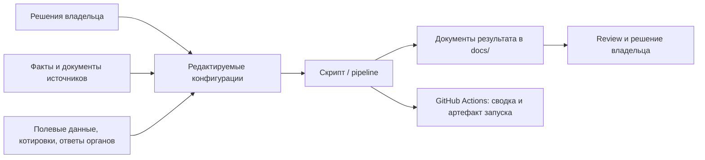
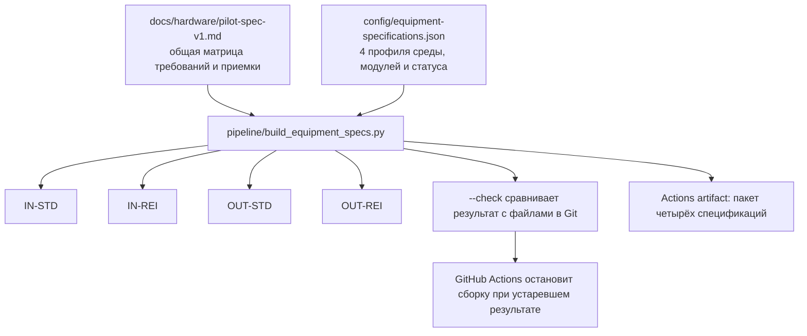

# Тур по проекту: что сделано и как это смотреть на GitHub

**Для кого:** владелец проекта, рецензенты, поставщики и участники пилота.\
**Цель:** за 5–10 минут показать рамки пилота, результаты пяти рабочих направлений, место исходных данных и результаты автоматических pipeline.\
**Актуальность:** статус и пути сверены с репозиторием 2026-10-11.

[Открыть проект](../../README.md) · [Карта документации](../README.md) · [Интегрированный план и контрольные ворота](../plans/integrated-pilot-artifacts-plan.md)

---

## Слайд 1. Что готовим

Пилот — **один уличный водомат** у жилого дома в Сурчине, Сербия. Оператор — DOO. Целевая аудитория — жители дома; доступ круглосуточный; принимаются наличные со сдачей и безналичная оплата.

Это пакет подготовки пилота, а не подтверждение прибыльности или разрешение на запуск. Закупка и эксплуатация остаются закрыты до появления данных о площадке, поставщике, применимых требованиях и экономике.

## Слайд 2. Результаты лежат в пяти местах

| № | Что подготовлено | Куда открыть на GitHub | Что ещё не закрыто |
|---:|---|---|---|
| 1 | Бизнес-модель с редактируемым canvas и расчётным pipeline | [Нарратив](business-model.md) · [расчёт](../economics/business-model-calculation.md) | Спрос и большая часть финансовых входов не подтверждены |
| 2 | Базовая спецификация и отдельные профили четырёх конфигураций | [Спецификация пилота](../hardware/pilot-spec-v1.md) · [каталог конфигураций](../hardware/specifications/) | Поставщик, серийная модель и закупочный BOM не выбраны |
| 3 | Методика обязательного фильтра, скоринга и паспорта площадки | [Scorecard](../hardware/site-selection-scorecard.md) | Нет обследованной и принятой площадки |
| 4 | Карта требований и проекты писем компетентным адресатам | [Карта требований](../certification/requirements-map.md) · [черновики запросов](../certification/regulatory-inquiry-drafts.md) | Применимость и ответы органов не установлены; письма не отправлены |
| 5 | Воспроизводимая экономика одной точки: вклад, BEP, CAPEX, стартовый cash, сценарии | [Руководство по входам](../economics/business-model-calculator-guide.md) · [отчёт](../economics/business-model-calculation.md) | 34 обязательных финансовых входа остаются незаполненными в текущем отчёте |

Порядок зависимостей и подробные критерии выхода каждого этапа — в [интегрированном плане](../plans/integrated-pilot-artifacts-plan.md).

## Слайд 3. Как отличать источник от результата

- **Исходные решения и факты** задают утверждённые границы и доказательства.
- **Конфиги и базовые матрицы** — места, где меняют входные данные.
- **Сгенерированные файлы** — результат запуска, их не редактируют вручную.
- **Actions artifact** — пакет конкретного запуска; он помогает показать или скачать результат, но не заменяет исходный документ в репозитории.

## Слайд 4. Pipeline бизнес-модели считает параметры

### Входы

- [`config/business-model-inputs.json`](../../config/business-model-inputs.json) хранит модель бизнеса, числовые параметры, сценарии и ссылки на источники.
- Ручной запуск GitHub Actions может подменить параметры формой или принять расширенный JSON через `parameters_json`.
- Неизвестные значения остаются `null` / «не найдено». Ноль означает подтверждённое отсутствие расхода.

### Что делает скрипт

`pipeline/business_model.py` проверяет входы, собирает canvas, рассчитывает unit economics точки, сценарии, чувствительность и статусы внешних гейтов. Считает только то, для чего есть входы. Неизвестное значение не превращается в ноль.

### Где результат

- В репозитории: [`business-model-calculation.md`](../economics/business-model-calculation.md) и [`business-model-flow.mermaid`](../economics/business-model-flow.mermaid).
- В GitHub Actions: вкладка **Actions** → **Calculate water-vending business model** → запуск → **Summary** для вердикта и диаграммы → **Artifacts** для отчёта, JSON, Mermaid и overrides.

Расчётный результат сейчас — **данных недостаточно**. Операционный прогноз точки не является полным P&L: он не показывает амортизацию, финансирование, налог на прибыль или чистую прибыль.

## Слайд 5. Зачем pipeline спецификаций, если требования статические

Спецификация содержит инженерные требования: что запросить у поставщика и как принимать аппарат. Сам генератор не придумывает эти требования. Он превращает базовую матрицу и четыре декларативных профиля в четыре синхронных документа.

Pipeline нужен для повторяемости и согласованности:

1. Общее требование или критерий приемки поддерживается в одном базовом источнике.
2. У каждого профиля — отдельные среда, защита, модули, применимость, доказательства и открытые параметры.
3. Одной командой создаются четыре standalone-документа. Это сокращает риск, что исправили один профиль, но забыли остальные.
4. `--check` повторно строит ожидаемые документы и обнаруживает расхождение с закоммиченными результатами. GitHub Actions запускает эту проверку на изменениях.

**Чего этот pipeline не делает:** не подбирает поставщика и SKU, не проектирует BOM, не подтверждает стоимость, температурный диапазон, IP-защиту или соответствие нормам. Он не оценивает физическую пригодность места. Это закрывается RFQ, паспортом площадки, документами поставщика, испытаниями и нормативной проверкой.

Поэтому результат сегодня — **воспроизводимая техническая основа RFQ и приёмки**, а не готовая спецификация заказа. Смотреть: [OUT-STD](../hardware/specifications/out-std-v1.md) — уличный стандартный профиль-кандидат пилота; [все профили](../hardware/specifications/).

## Слайд 6. Как запустить на GitHub

### Пересчитать бизнес-модель

1. Откройте вкладку **Actions** репозитория.
2. Выберите **Calculate water-vending business model**.
3. Нажмите **Run workflow**, выберите ветку и заполните известные входы. Дополнительные параметры и источники можно передать в `parameters_json`.
4. Откройте завершённый запуск: **Summary** показывает верхний вывод, сценарии и диаграмму; **Artifacts** содержит полный пакет.

### Собрать спецификации

1. В **Actions** выберите **Build equipment configuration specifications**.
2. Нажмите **Run workflow**.
3. Успешный запуск означает, что файлы в Git совпали с генератором и собран новый пакет. Изменение `config/equipment-specifications.json`, общей матрицы или генератора также запускает workflow при push.

Локальные эквиваленты и работа с параметрами описаны в [runbook](../process/business-model-and-equipment-runbook.md).

## Слайд 7. Что означает успешная сборка

| Workflow | Успех подтверждает | Успех не подтверждает |
|---|---|---|
| Business model calculation | Входы распознаны, модель рассчитана где хватает данных, отчёт/диаграмма/JSON сформированы | Прибыльность, качество исходных фактов, юридический допуск или go/no-go пилота |
| Equipment specifications | Четыре файла синхронны с матрицей и профилями; артефакты сборки загружены | Инженерную правильность неподтверждённых данных, BOM, соответствие поставщика или готовность к заказу |

Pipeline обеспечивает повторяемый расчёт и выпуск документов. Качество решений зависит от доказанных входов и человеческого review.

## Слайд 8. Где находится каждый из пяти пунктов

**Как читать статусы:** «подготовлено» означает, что есть рабочий документ или воспроизводимый метод; «ворота пройдены» означает, что выполнены условия перехода этапа по плану. Это разные вещи. Сейчас ни один из пяти этапов не дает разрешения покупать аппарат или запускать точку.

| Пункт | Уже подготовлено | Этап и состояние ворот | Что нужно для перехода дальше |
|---|---|---|---|
| **1. Бизнес-модель** | Контур пилота принят владельцем: одна уличная точка 24/7 у жилого дома, DOO, жители дома, наличная и безналичная оплата. Есть canvas и исполняемый расчётный pipeline. | **Контур согласован; этап подготовки не закрыт.** Спрос, площадка, право и экономика не подтверждены. | Собрать наблюдения спроса и факты о площадке; внести подтверждённые значения с источниками; закрыть связанные правовые и финансовые блокеры. |
| **2. Спецификации оборудования** | Базовая матрица требований/приёмки для RFQ и 4 воспроизводимых профиля конфигураций. Для уличного пилота выделен профиль-кандидат OUT-STD. | **Baseline для RFQ готова; закупочные ворота не пройдены.** Нет выбранной модели, BOM и доказательств по открытым требованиям. | Получить сопоставимые предложения поставщиков с моделью, составом поставки, полной стоимостью, условиями эксплуатации, сервисом и подтверждающими документами; проверить отклонения и приемку. |
| **3. Критерии и скоринг точки** | Обязательный фильтр, 10 равновесных факторов по шкале 0–5 и форма паспорта кандидата. Максимум — 50; равные веса являются стартовым решением владельца. | **Методика принята; этап выбора площадки открыт.** Ни один кандидат не обследован и не оценен; численный проходной порог не задан. | Обследовать реальные места и собрать доказательства для обязательных фильтров и факторов; владелец задает порог после сбора данных, до ранжирования; затем письменно выбрать площадку и условия. |
| **4. Карта норм и разрешений** | Карта областей проверки, первичные источники и проекты запросов адресатам. | **Исследовательская карта и черновики готовы; путь допуска к запуску открыт.** Применимость, регистрации, метрология, фискализация, модель оборудования, лаборатория и монтаж не закрыты. Запросы не отправлялись. | Сверить актуальные источники и адресатов, получить профильные заключения/ответы и доказательства применимости, оформить требуемый пакет допуска. Черновики можно отправить только после сверки; сроков ответов пока нет. |
| **5. Финансовая модель и unit economics** | Калькулятор одной точки считает из вводимых параметров и сохраняет неизвестное как «не найдено»; учтены сценарии и ограничения выводов. | **Методика готова; финансовые ворота не пройдены.** Текущий отчёт показывает 34 незаполненных обязательных поля; бюджет не утвержден, показатели решения не определяются. | Подтвердить входы документами/котировками и договорными условиями; пересчитать вклад, BEP, CAPEX, стартовый cash и сценарии; владелец утверждает бюджет и финансовые пределы. |

**Общий этап проекта:** интеграция и go/no-go **не пройдены**. Для решения нужны выбранная площадка и договорные условия, предложения и проверка оборудования, пакет разрешительных доказательств, заполненная модель и утверждённый бюджет, затем review владельца. Назначенные исполнители треков также пока не зафиксированы. Подробный журнал, зависимости и критерии выхода — в [интегрированном плане](../plans/integrated-pilot-artifacts-plan.md); он остается источником проектного статуса.

## Слайд 9. Короткий сценарий показа

1. Начните с [README проекта](../../README.md): цель пилота и текущие блокеры.
2. Покажите [интегрированный план](../plans/integrated-pilot-artifacts-plan.md): пять направлений, зависимости и контрольные ворота.
3. Откройте [бизнес-модель](business-model.md) и отчёт: откуда берутся входы, почему сейчас нет финансового вердикта.
4. Покажите [общую матрицу](../hardware/pilot-spec-v1.md), профиль [OUT-STD](../hardware/specifications/out-std-v1.md) и этот слайд: pipeline собирает документацию по профилям, но не подменяет RFQ/BOM.
5. В **Actions** откройте запуск соответствующего workflow и покажите summary/artifact.
6. Завершите [scorecard](../hardware/site-selection-scorecard.md) и [картой требований](../certification/requirements-map.md): именно эти внешние ворота всё ещё закрыты.

## Слайд 10. Одна фраза о результате

Подготовлен воспроизводимый пакет для планирования и review пилота: бизнес-модель считает только по введённым и маркированным данным, генератор выпускает четыре согласованных профиля оборудования, а scorecard и карта требований задают дальнейшие проверки. **Коммерческая жизнеспособность, закупочная готовность и законный допуск к запуску пока не доказаны.**

---

## Ссылки для демонстрации

- [Корень репозитория](../../README.md)
- [Карта документации](../README.md)
- [Пять GitHub Issues и управление через CLI](../process/github-issue-management.md)
- [Business model workflow](../../.github/workflows/business-model-calculation.yml)
- [Equipment specifications workflow](../../.github/workflows/equipment-specifications.yml)
- [Business model source config](../../config/business-model-inputs.json)
- [Equipment profile config](../../config/equipment-specifications.json)
